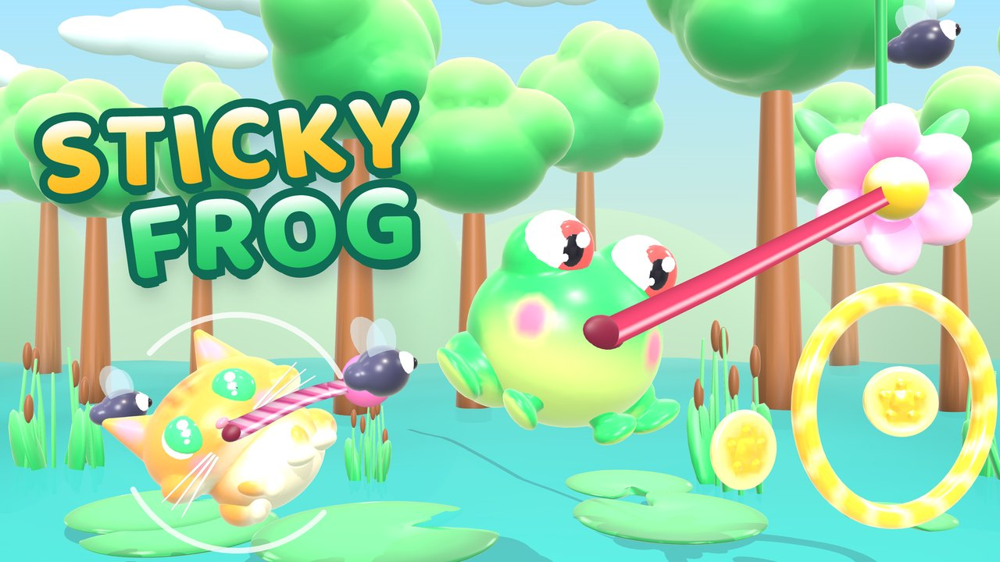
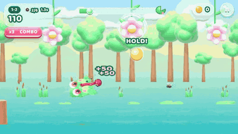
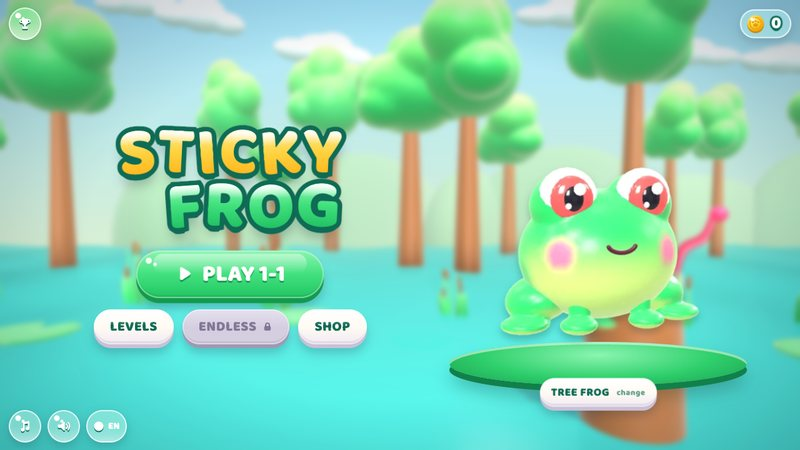
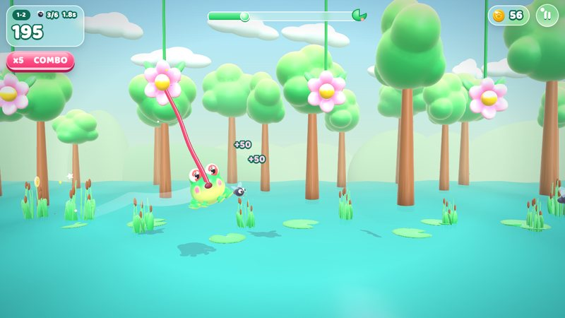
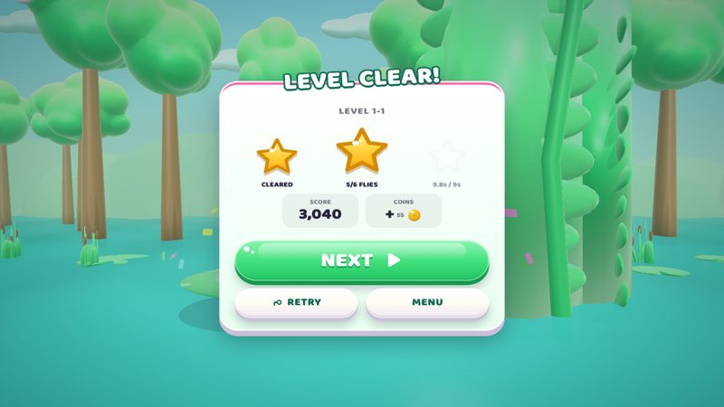
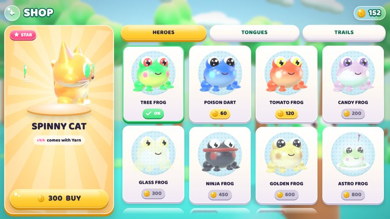
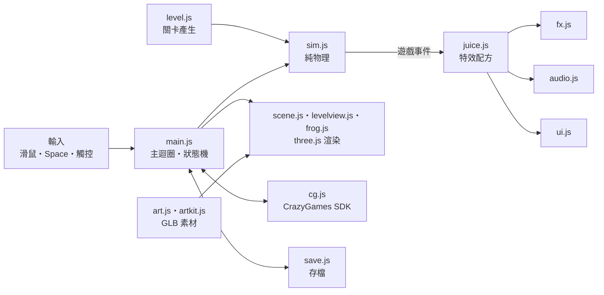

<p align="center">
  
</p>

<h3 align="center">按住，舌頭黏上去；放開，飛出去。</h3>

<p align="center">
  一個按鍵的青蛙擺盪遊戲。為 <a href="https://www.crazygames.com">CrazyGames</a> 製作，桌機與手機都能玩。
</p>

<p align="center">
  
  
  
  
</p>

<p align="center">
  
</p>

---

## 玩法

側視 2.5D：青蛙只在一個平面上移動，世界是 3D 加景深。

- **按住**：舌頭射向前方最近的鉤點花，黏住後開始擺盪。按得越久，舌頭收得越短、擺得越快。
- **放開**：帶著擺盪的速度飛出去，依速度在空中翻滾。轉一圈是 FLIP，兩圈 DOUBLE，三圈 TRIPLE。
- 飛過蒼蠅會自動舔掉，穿過金圈加分，彈跳蘑菇把你彈回空中。
- 碰到尖刺、鋸片，或掉進水裡（糖漿、霓虹運河、岩漿），就從頭再來。
- 落在終點的大荷葉上就過關。

## 內容

| | |
|---|---|
| 關卡 | 90 關，每 15 關一個世界：Jungle、Candy、Neon City、Volcano、Frostbite Peaks、Sunset Dunes（76 關起有滑沙：落在沙丘上不會死，沿坡面往前滑、從尾端坡頂被拋起；沙面上有一排金圈引路，拿掉沙丘也過得了） |
| 評星 | 過關 1 顆；吃到七成以上的蒼蠅加 1 顆；在標準時間內過關再加 1 顆 |
| 無盡模式 | 破第 5 關解鎖。越遠越難，每跑一段換一個世界 |
| 成就 | 打出漂亮的操作時當場跳出來稱讚：SPIN DOCTOR（一次滯空轉 5 圈）、FROGNADO（7 圈）、NONSTOP、SPEED DEMON、WAVE KISSER、CLOSE SHAVE、CLUTCH SAVE |
| 商店 | 12 個角色（看板角色 Spinny Cat、9 隻青蛙、Vine Ape、Silk Frog）、4 種舌頭、5 種拖尾 |
| 語言 | English、Español、Português、Français、Deutsch、Türkçe、Русский、日本語、한국어、Indonesia、繁體中文、简体中文 |
| 存檔 | 在 CrazyGames 上用 SDK 的雲端存檔，其他環境存在 localStorage |

<table>
  <tr>
    <td></td>
    <td></td>
  </tr>
  <tr>
    <td></td>
    <td></td>
  </tr>
</table>

## 操作

| 平台 | 擺盪 | 其他 |
|---|---|---|
| 桌機 | 按住滑鼠左鍵或 Space（↑、W、→、D 也可以） | Esc／P 暫停，R 重來 |
| 手機 | 按住螢幕任何位置 | 右上角暫停鈕 |

## 快速開始

需要 Node.js 18 以上。

```bash
npm install
npm run dev        # 開發伺服器，網址看終端機輸出
npm run build      # 輸出到 dist/，這份就是上傳 CrazyGames 的版本
npm run preview    # 在本機跑 dist/
```

`dist/` 裡全部用相對路徑（`vite.config.js` 的 `base: './'`），放在任何子路徑底下都能跑。

| 建置旗標 | 作用 |
|---|---|
| （無） | Basic Launch 版。CrazyGames 在 Basic Launch 期間不放廣告，所以不顯示「看影片 x2」按鈕 |
| `VITE_FULL_LAUNCH=1` | Full Launch 版，顯示無盡模式結算的「看影片 x2」 |

## 專案結構

```
src/
├── main.js          主迴圈、狀態機、鏡頭、輸入
├── sim.js           純物理（不依賴 three.js，可以在 Node 跑）
├── level.js         種子程序產生的關卡、無盡模式段落
├── bot.js           自動玩家（驗證關卡可破、截圖巡覽用）
├── feats.js         成就偵測與門檻
├── save.js          存檔、舊存檔相容、選單「下一步」推薦（純邏輯）
├── config.js        所有調參常數：物理、鏡頭、世界色盤、角色、舌頭、拖尾
├── scene.js         three.js 場景、天空、水面、後製
├── levelview.js     關卡物件的 3D 外觀（同種物件用 InstancedMesh）
├── frog.js          主角模型、擠壓伸展、眨眼、舌頭緞帶
├── tongues.js       舌頭材質（程式畫的貼圖：毛線、藤蔓、蛛絲）
├── art.js           載入 GLB 素材、畫質切換
├── artkit.js        美術 runtime：換色、軟膠材質
├── fx.js            粒子、衝擊環、拖尾、畫面震動
├── juice.js         每個遊戲事件的特效配方（停格、慢動作、粒子、震動、音效）
├── audio.js         WebAudio 即時合成的音效與每個世界的音樂（沒有音檔）
├── ui.js            DOM 介面：選單、HUD、結算、商店
├── i18n.js, lang/   12 種語言、語言偵測、長字自動縮字
├── leaderboard.js   本機前 10 名＋CrazyGames 排行榜接口
└── cg.js            CrazyGames SDK v3 包裝
public/
├── models/          GLB 模型（Blender 製作、meshopt 壓縮）
├── ui/              商店角色頭像
└── fonts/           Baloo 2 ExtraBold（SIL OFL 1.1）
tests/               Node 檢查與瀏覽器冒煙步驟
```

### 架構



物理（`sim.js`）和關卡（`level.js`）不碰 three.js，所以 Node 裡的自動玩家跑的就是遊戲裡同一套物理。調關卡難度可以先在 Node 驗證每一關都破得了，不用開瀏覽器。

## 調參

| 想改什麼 | 去哪裡 |
|---|---|
| 重力、舌頭、翻滾、分數、鏡頭、慢動作 | `src/config.js` 的 `TUNE` |
| 世界色盤、天空、水 | `src/config.js` 的 `WORLDS` |
| 角色、舌頭、拖尾、價格 | `src/config.js` 的 `SKINS`、`TONGUES`、`TRAILS` |
| 關卡段落與難度曲線 | `src/level.js` |
| 成就門檻 | `src/feats.js` 的 `FEAT_T` |
| 無盡模式解鎖關 | `src/save.js` 的 `ENDLESS_UNLOCK` |

## 測試

Node 檢查，不需要瀏覽器：

```bash
for f in tests/*-check.mjs; do node "$f" > /dev/null && echo "ok   $f" || echo "FAIL $f"; done
```

| 檢查 | 內容 |
|---|---|
| `sim-check.mjs` | 自動玩家用 12 組參數跑全部關卡，每一關都要破得了 |
| `endless-check.mjs` | 無盡模式用 12 個種子接力跑完 |
| `feats-check.mjs` | 每種成就「達成」與「差一點」都判對 |
| `save-check.mjs` | 舊存檔相容、下一步推薦、本機排行 |
| `i18n-check.mjs` | 12 種語言的字串齊全 |
| `unlock-check.mjs`、`pad-check.mjs`、`boost-check.mjs`、`burst-check.mjs` | 解鎖順序、中途荷葉、加速圈、特效數量上限 |

`tests/smoke-*.json` 是瀏覽器冒煙步驟，用 Playwright 實際開遊戲操作。執行工具（`smoke.sh`、`shot.mjs`）目前放在這個 repo 外面，還沒搬進來。

開發用的掛鉤在 `window.__game`，例如 `__game.start(12)` 直接開第 12 關、`__game.autoplay = [0.25, -10]` 讓自動玩家接手、`__game.look('cat')` 換角色。

## 目前狀態

- 第一次送 CrazyGames 審核未通過（整體品質）。正在改善手機效能：開機只載需要的素材、畫質分級、閒置時不重畫。
- 下一階段：加強爽感、增加關卡內容（第 6 個世界 Sunset Dunes 製作中）。
- 開發筆記（手感清單、每個設計決定的原因、驗證方式）在 [`docs/DEVNOTES.md`](docs/DEVNOTES.md)。

## 素材與授權

- 3D 模型：自製（Blender），來源在另一個美術 repo。
- 字型：[Baloo 2](https://fonts.google.com/specimen/Baloo+2) ExtraBold，SIL Open Font License 1.1（`public/fonts/OFL-Baloo2.txt`）。
- 音效與音樂：WebAudio 即時合成，沒有外部音檔。
- [three.js](https://threejs.org)：MIT License。
- 本專案程式碼目前不開源，尚未選定授權。
