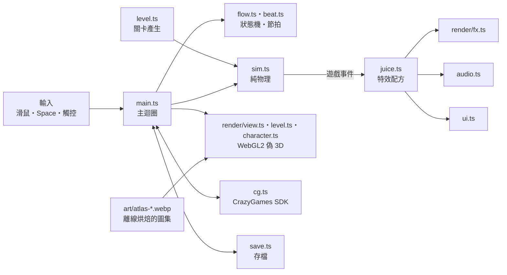

<p align="center">
  
</p>

<h3 align="center">按住，舌頭黏上去；放開，飛出去。</h3>

<p align="center">
  一個按鍵的青蛙擺盪遊戲。為 <a href="https://www.crazygames.com">CrazyGames</a> 製作，桌機與手機都能玩。
</p>

<p align="center">
  
  
  
</p>

<p align="center">
  
</p>

---

## 玩法

側視 2.5D：青蛙只在一個平面上移動，世界是 3D 加景深。

- **按住**：舌頭射向前方最近的鉤點花，黏住後開始擺盪。按得越久，舌頭收得越短、擺得越快。
- **放開**：帶著擺盪的速度飛出去，依速度在空中翻滾。轉一圈是 FLIP，兩圈 DOUBLE，三圈 TRIPLE。
- 飛過蒼蠅會自動舔掉，穿過金圈加分，彈跳蘑菇把你彈回空中。
- 碰到尖刺、鋸片，或掉進水裡（糖漿、霓虹運河、岩漿），就從頭再來。
- 落在終點的大荷葉上就過關。

## 內容

| | |
|---|---|
| 關卡 | 90 關，每 15 關一個世界：Jungle、Candy、Neon City、Volcano、Frostbite Peaks、Sunset Dunes（76 關起有滑沙：落在沙丘上不會死，沿坡面往前滑、從尾端坡頂被拋起；沙面上有一排金圈引路，拿掉沙丘也過得了） |
| 評星 | 過關 1 顆；吃到七成以上的蒼蠅加 1 顆；在標準時間內過關再加 1 顆 |
| 無盡模式 | 破第 5 關解鎖。越遠越難，每跑一段換一個世界 |
| 成就 | 打出漂亮的操作時當場跳出來稱讚：SPIN DOCTOR（一次滯空轉 5 圈）、FROGNADO（7 圈）、NONSTOP、SPEED DEMON、WAVE KISSER、CLOSE SHAVE、CLUTCH SAVE |
| 商店 | 12 個角色（看板角色 Spinny Cat、9 隻青蛙、Vine Ape、Silk Frog）、4 種舌頭、5 種拖尾 |
| 語言 | English、Español、Português、Français、Deutsch、Türkçe、Русский、日本語、한국어、Indonesia、繁體中文、简体中文 |
| 存檔 | 在 CrazyGames 上用 SDK 的雲端存檔，其他環境存在 localStorage |

<table>
  <tr>
    <td></td>
    <td></td>
  </tr>
  <tr>
    <td></td>
    <td></td>
  </tr>
</table>

## 操作

| 平台 | 擺盪 | 其他 |
|---|---|---|
| 桌機 | 按住滑鼠左鍵或 Space（↑、W、→、D 也可以） | Esc／P 暫停，R 重來 |
| 手機 | 按住螢幕任何位置 | 右上角暫停鈕 |

## 快速開始

需要 [Bun](https://bun.sh)（有 `devenv.nix`，用 devenv 的話 `devenv shell` 就有）。

```bash
bun install
bun run dev        # 開發伺服器（5173）
bun run build      # 輸出到 dist/，這份就是上傳 CrazyGames 的版本
bun run preview    # 在本機跑 dist/
bun run check      # 型別、oxlint、tests/*-check.mjs
```

`dist/` 裡全部用相對路徑（`vite.config.ts` 的 `base: './'`），放在任何子路徑底下都能跑。

目前不接廣告：CrazyGames 在 Basic Launch 期間不放廣告，Full Launch 時再加回。

## 專案結構

```
src/
├── main.ts          主迴圈、輸入、鏡頭、事件 → 手感回饋
├── flow.ts          流程狀態機（純函式）；beat.ts 一局結束的固定節拍
├── sim.ts           純物理（不依賴渲染器，可以在 Node／Bun 跑）
├── level.ts         種子程序產生的關卡、無盡模式段落、主題系列關卡
├── bot.ts           自動玩家（驗證關卡可破、截圖巡覽用）
├── feats.ts         成就偵測與門檻
├── save.ts          存檔、舊存檔相容、本機與雲端合併、選單「下一步」推薦（純邏輯）
├── config.ts        所有調參常數：物理、鏡頭、世界色盤、角色、舌頭、拖尾、主題資料包
├── render/          自寫 WebGL2 偽 3D：gl（精靈批次）、atlas（圖集用到才載）、view（投影、天空、水面、視差捲軸層）、
│                    level、character、fx（粒子）、paint＋palette（小形狀與色盤）、portraits／cat-stage（頭像、旋轉貓）
├── art/             離線烘焙的精靈圖集（atlas-*.webp＋json）：共用、小形狀、六個世界、每個造型、旋轉貓
├── juice.ts         每個遊戲事件的特效配方（停格、慢動作、粒子、震動、音效；選單出來後才載）
├── audio.ts         音效門面；audio-engine.ts 是 WebAudio 即時合成（第一次手勢才載，沒有音檔）
├── ui.ts            DOM 介面：選單、HUD、過關與無盡結束浮層、商店、選關
├── i18n.ts, lang/   12 種語言（各自小檔、用到才載）、語言偵測、長字自動縮字
├── telemetry.ts     匿名遊玩數據（沒設 VITE_TELEMETRY_URL 時是空殼）
├── leaderboard.ts   本機前 10 名＋CrazyGames 排行榜接口
└── cg.ts            CrazyGames SDK v3 包裝（存檔本機永遠鏡像）
public/
├── ui/              商店角色頭像
└── fonts/           Baloo 2 ExtraBold（SIL OFL 1.1）
tools/
├── bake/            離線烘焙：原版 GLB → 精靈圖集（無頭 Chrome）、小形狀光柵
├── cat/             旋轉貓素材（yt-dlp＋ffmpeg）
└── perf/            Playwright 量測與驗證腳本（開機、遊玩剖析、流程、主題、截圖）
server/telemetry/    遙測收資料端（Worker＋D1）與報告腳本
tests/               bun run check 跑的檢查（*-check.mjs）與瀏覽器冒煙步驟
```

### 架構



物理（`sim.ts`）和關卡（`level.ts`）不碰渲染器，所以 Node／Bun 裡的自動玩家跑的就是遊戲裡同一套物理。調關卡難度可以先在 Node 驗證每一關都破得了，不用開瀏覽器。

## 調參

| 想改什麼 | 去哪裡 |
|---|---|
| 重力、舌頭、翻滾、分數、鏡頭、慢動作 | `src/config.ts` 的 `TUNE` |
| 世界色盤、天空、水 | `src/config.ts` 的 `WORLDS` |
| 角色、舌頭、拖尾、價格 | `src/config.ts` 的 `SKINS`、`TONGUES`、`TRAILS` |
| 關卡段落與難度曲線 | `src/level.ts` |
| 成就門檻 | `src/feats.ts` 的 `FEAT_T` |
| 無盡模式解鎖關 | `src/save.ts` 的 `ENDLESS_UNLOCK` |

## 測試

Node 檢查，不需要瀏覽器：

```bash
for f in tests/*-check.mjs; do node "$f" > /dev/null && echo "ok   $f" || echo "FAIL $f"; done
```

| 檢查 | 內容 |
|---|---|
| `sim-check.mjs` | 自動玩家用 12 組參數跑全部關卡，每一關都要破得了 |
| `endless-check.mjs` | 無盡模式用 12 個種子接力跑完 |
| `feats-check.mjs` | 每種成就「達成」與「差一點」都判對 |
| `save-check.mjs` | 舊存檔相容、下一步推薦、本機排行 |
| `i18n-check.mjs` | 12 種語言的字串齊全 |
| `telemetry-check.mjs` | 遙測：沒設網址不送、事件欄位、排隊分批、不送的情況 |
| `unlock-check.mjs`、`pad-check.mjs`、`boost-check.mjs`、`burst-check.mjs` | 解鎖順序、中途荷葉、加速圈、特效數量上限 |

`tests/smoke-*.json` 是瀏覽器冒煙步驟，用 Playwright 實際開遊戲操作。執行工具（`smoke.sh`、`shot.mjs`）目前放在這個 repo 外面，還沒搬進來。

開發用的掛鉤在 `window.__game`，例如 `__game.start(12)` 直接開第 12 關、`__game.autoplay = [0.25, -10]` 讓自動玩家接手、`__game.look('cat')` 換角色。

## 遊玩數據

匿名記錄「哪一關、哪個位置死掉或離開」，用來找太難、太簡單、讓人離開的關卡。**預設關閉**：建置時沒設 `VITE_TELEMETRY_URL` 就完全不發請求。

```bash
# 開啟（建置版本建議帶 commit）
VITE_TELEMETRY_URL=https://<你的 worker>.workers.dev/e VITE_BUILD=$(git rev-parse --short HEAD) bun run build
```

- 事件：`session_start`、`level_start`、`death`、`level_clear`、`level_abandon`、`endless_over`、`shop_want`、`shop_buy`（欄位見 `server/telemetry/src/index.js` 的 `EVENTS`）。
- 存：隨機匿名 ID（localStorage）、每次載入的 session ID、版本、關卡、位置、進度、死因、秒數、星數、語言、裝置類別（桌機／手機）、視窗大小、畫質、開機到選單的毫秒、國家（Cloudflare 提供）。
- 不存：個資、IP、user agent、cookie。
- 不送：`?notelemetry`、`__game.autoplay` 開著的局、localhost 開發（遙測網址本身也是 localhost 的本機測試除外）。
- 新玩家第一次看到選單會有一行小字通知，連到 `public/privacy.html`（英文＋繁中）。
- 收資料端在 `server/telemetry/`（Cloudflare Worker＋D1）。部署：複製 `wrangler.toml` 成 gitignored 的 `wrangler.local.toml` 並填入自己的 D1 `database_id`，`npx wrangler d1 execute sticky-frog-telemetry -c wrangler.local.toml --remote --file schema.sql`，再 `npx wrangler deploy -c wrangler.local.toml`。在加入商店欄位之前就建好的資料庫，另外跑一次 `--file migrate-0001-shop.sql`。
- 看報告：`node server/telemetry/report.mjs`（查線上 D1，輸出 markdown：每關通關率、死亡／放棄位置、關卡漏斗、開機時間；異常樣本篩除規則寫在報告開頭）。`--local` 查本機 D1、`--out 檔名` 寫檔。
- 驗證：`bun tests/telemetry-check.mjs`（遊戲端）；`cd server/telemetry && npm ci && npm test`（收資料端，在 workerd 裡跑、用全新的本機 D1）；部署後用 `node server/telemetry/test-worker.mjs <端點> --remote` 檢查線上端點。

## 目前狀態

- 第一次送 CrazyGames 審核未通過（整體品質）。之後把渲染器從 three.js 換成自寫 WebGL2 偽 3D（素材離線烘焙成圖集）、開機只載需要的素材、一局結束改成無按鈕的固定節拍、障礙物改全年齡、加主題資料包；數字與計畫見 `docs/PLAN.md`、`docs/REVIEW-2026-10-30.md`。
- 開發筆記（手感清單、每個設計決定的原因、驗證方式）在 [`docs/DEVNOTES.md`](docs/DEVNOTES.md)。

## 素材與授權

- 精靈圖集：自製 3D 模型（Blender，來源在另一個美術 repo）用 `tools/bake/` 離線烘焙；旋轉貓是網路迷因照片與音效（來源見 `tools/cat/`）。
- 字型：[Baloo 2](https://fonts.google.com/specimen/Baloo+2) ExtraBold，SIL Open Font License 1.1（`public/fonts/OFL-Baloo2.txt`）。
- 音效與音樂：WebAudio 即時合成，沒有外部音檔。
- [three.js](https://threejs.org)（只在 `tools/bake/` 烘焙時用）：MIT License。
- 本專案程式碼目前不開源，尚未選定授權。
